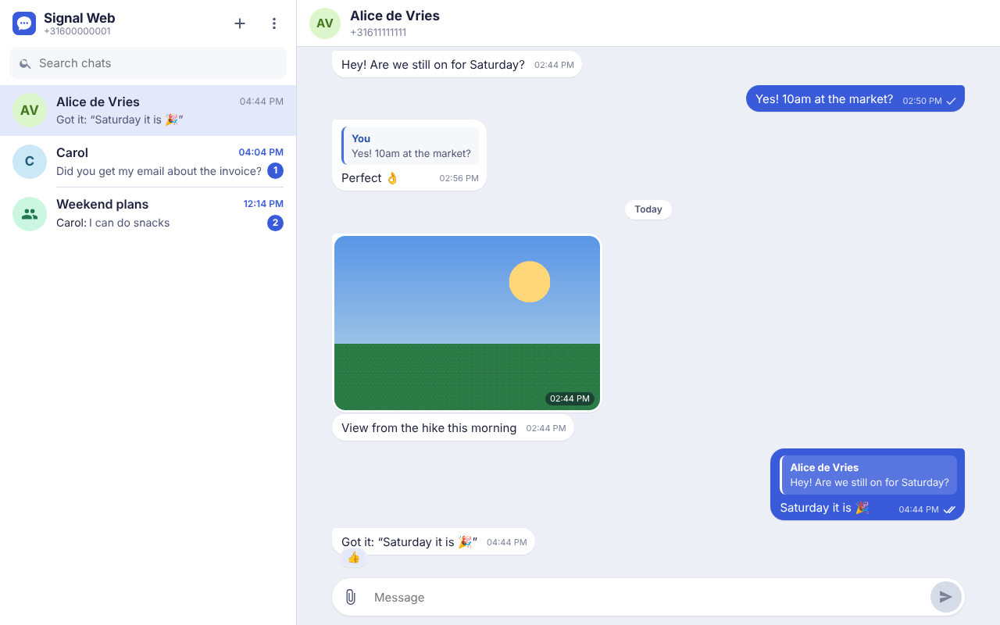
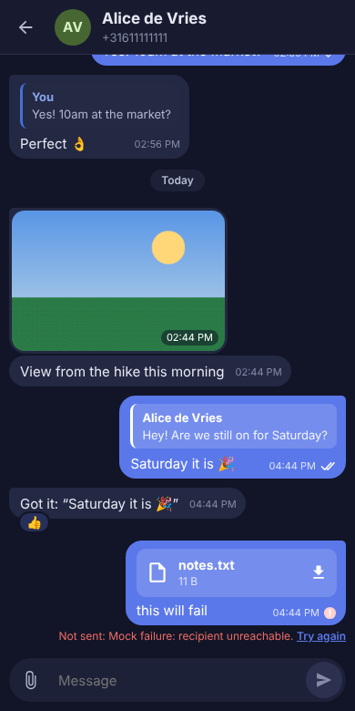

# Caution: 100% Vibe Code. No Guarantees. Do not expose to the internet. Internal use only

# Signal Web

A WhatsApp-Web-style browser client for [Signal](https://signal.org), self-hosted on Unraid (or any Docker host).
It links to your phone as a Signal device, just like Signal Desktop, and gives you your chats in any browser.



Under the hood it talks to [bbernhard/signal-cli-rest-api](https://github.com/bbernhard/signal-cli-rest-api), which wraps [signal-cli](https://github.com/AsamK/signal-cli).

```
Browser  ──HTTPS/SSE──▶  signal-web  ──REST + WebSocket──▶  signal-api  ──▶  Signal servers
                         (UI, auth, history DB)              (signal-cli, keys)
```

## What works

- Linking via QR code, right in the web UI
- Chat list with unread counts, search, typing and delivery state
- 1:1 and group chats, with history stored in SQLite
- Text, links, replies (quotes), reactions (quick bar plus every emoji), @mentions shown by name
- Emoji picker, and Slack/WhatsApp-style `:shortcode` suggestions (`:lau` → 😆, `:thumbsup:` → 👍)
- GIF picker (Giphy, needs a free key; see [Settings](#settings)); received GIFs loop silently
- Stickers: shown in chats, sent from the sticker tab (packs installed on your phone appear automatically), and new packs added by pasting a signal.art link
- Settings: your profile (picture, first name, about), light/dark/system theme, Enter-to-send, notifications and their previews, read receipts and typing indicators, sign out everywhere
- Change a group's picture from Group info (if the group lets you)
- Resizable chat list: drag the divider, or double-click it to reset
- Sending and receiving images, video, audio and files (paste, drag-and-drop or the paperclip)
- Group and contact info: description, members and admins, profile pictures, shared media, docs and links
- Delivery and read ticks, plus per-person "Read by / Delivered to" in Message info
- Read receipts and typing indicators, both ways
- Edit your own text messages for 24 hours (↑ in an empty message box edits your last one), delete for everyone, retry failed sends
- Edits and deletes made by others are shown
- Browser notifications, dark mode, layout for wide screens and phones

In a group, the ticks turn into two outlined circles once anyone has received the message, and fill in once every member has read it. Message info (ⓘ on your own messages) shows exactly who has received and read it. People who switched off read receipts never count as read, so with such a member in the group the ticks stay outlined.

**Not supported**: voice/video calls, stories, message history from before linking (signal-cli doesn't support Signal's history transfer), editing messages that have attachments, changing your last name (the Signal API only sets the first name), polls (shown as text), view-once media.

Stickers are downloaded from Signal's CDN (`cdn.signal.org`) by the signal-web container and decrypted there, like Signal Desktop does, so that container needs outbound internet access.

## Install on Unraid

### 1. Create the Docker network

Both containers talk over a private network, so the Signal API is never exposed to your LAN.

1. **Settings → Docker**: stop Docker, switch to *Advanced view*, set **Preserve user defined networks** to *Yes*, start Docker.
2. Open the Unraid terminal and run:

   ```sh
   docker network create signal
   # signal-api runs as uid 1000 and can't fix folder ownership itself
   mkdir -p /mnt/user/appdata/signal-api && chown -R 1000:1000 /mnt/user/appdata/signal-api
   ```

### 2. Add the templates

In the Unraid terminal:

```sh
cd /boot/config/plugins/dockerMan/templates-user
wget -O my-signal-api.xml https://raw.githubusercontent.com/WCAve/Signal_Web/main/unraid/signal-api.xml
wget -O my-signal-web.xml https://raw.githubusercontent.com/WCAve/Signal_Web/main/unraid/signal-web.xml
```

If the repository is private, download the two files from GitHub and copy them into that folder instead.

### 3. Create the containers

**Docker → Add Container**, pick the template, review, **Apply**. Do them in this order:

1. **signal-api**: the defaults are right (`MODE=json-rpc-native`, `JSON_RPC_RECEIVE_MODE=manual`, network `signal`). Use `MODE=json-rpc` instead if you prefer stability over memory use: it runs signal-cli on a regular Java runtime instead of the GraalVM-compiled binary. Both use the same data, so you can switch any time.

2. **signal-web**: set a **Password** (8+ characters, longer is better). Leave the Signal API URL at `http://signal-api:8080`.

If the GitHub repository is private, its container image is private too, and Unraid can't pull it.
Either make the package public (GitHub → your profile → Packages → signal_web → Package settings → Change visibility), or log in once from the Unraid terminal with a personal access token that has `read:packages`:

```sh
docker login ghcr.io -u WCAve
```

### Alternative: the Community Applications "Signal-API" template, in bridge mode

You can use the existing **Signal-API** app from Community Applications instead of `unraid/signal-api.xml`, with both containers on the default bridge network. Its defaults don't work with Signal Web, so change them before the first start:

1. **Mode**: set to `json-rpc` (or `json-rpc-native`). `normal` and `native` don't work with Signal Web.
2. **Receive Schedule**: click **Remove**. Clearing the value isn't enough: in json-rpc mode signal-api refuses to start while the `AUTO_RECEIVE_SCHEDULE` variable exists, even when it's empty. It would also pull messages behind Signal Web's back.
3. **Add another Path, Port, Variable…** → Config Type *Variable*, Key `JSON_RPC_RECEIVE_MODE`, Value `manual`.
4. **Apply**, then fix the folder ownership in the Unraid terminal (use the path shown under *AppData*) and start the container again:

   ```sh
   chown -R 1000:1000 /mnt/cache/appdata/signal-api
   ```

   Without this, the log repeats `Couldn't persist jsonrpc2.yaml: … permission denied`.
5. In **signal-web**, set the network to *bridge* and the Signal API URL to the host IP and the template's port, which defaults to **8739**: `http://<unraid-ip>:8739`.

In bridge mode the Signal API's port is reachable by anything that can reach your server, and it has no login of its own. Use this only on a network you trust; the private `signal` network above avoids it.

### 4. Link your phone

Open `http://<unraid-ip>:3000`, sign in, and scan the QR code from your phone: **Signal → Settings → Linked devices → Link new device**.
Contacts and groups sync from your phone over the next few minutes.

### Updating

Unraid shows "update ready" for both containers as new images are published. Keep **signal-api** reasonably current: Signal stops accepting old signal-cli versions after a few months.

### Backups

Back up both appdata folders:

- `/mnt/user/appdata/signal-api` holds your Signal keys. Losing it means re-linking.
- `/mnt/user/appdata/signal-web` holds chat history and attachments.

## Security notes

- Your Signal keys and message history live on the server. Anyone with the password, or with access to the appdata folders, can read and send as you. Treat it like a logged-in Signal Desktop.
- Keep it on your LAN or behind a VPN (Tailscale, WireGuard). If you put it behind a reverse proxy with HTTPS, set `SECURE_COOKIES=true`.
- Login is rate-limited (10 failed attempts per IP per 15 minutes) and sessions are http-only, same-site cookies.
- When a contact's safety number changes, signal-api follows `JSON_RPC_TRUST_NEW_IDENTITIES` (default `on-first-use`). Verify safety numbers on your phone.

## Settings

| Variable | Default | |
|---|---|---|
| `APP_PASSWORD` | (required) | Web UI password, 8+ characters |
| `SIGNAL_API_URL` | `http://signal-api:8080` | Where the signal-api container is |
| `SIGNAL_NUMBER` | first linked account | Only if signal-api holds several accounts |
| `GIPHY_API_KEY` | (none) | Enables the GIF picker. Free: [developers.giphy.com](https://developers.giphy.com/dashboard/) → Create an App → API. The browser talks to Giphy directly, as Giphy's terms require |
| `GIPHY_RATING` | `pg-13` | Content rating for GIF results: `g`, `pg`, `pg-13`, `r` |
| `SEND_READ_RECEIPTS` | `true` | Send read receipts when you open a chat. Default only: the switch in Settings overrides it |
| `SEND_TYPING_INDICATORS` | `true` | Send typing indicators. Default only: the switch in Settings overrides it |
| `SECURE_COOKIES` | `false` | Set `true` when served over HTTPS |
| `SESSION_DAYS` | `30` | How long a browser stays signed in |
| `MAX_UPLOAD_MB` | `100` | Largest attachment you can send |
| `PUID` / `PGID` | `99` / `100` | Owner of files in `/data` |
| `DATA_DIR` | `/data` | Database and attachments |
| `PORT` | `3000` | HTTP port |
| `LOG_LEVEL` | `info` | `debug`, `info`, `warn`, `error`. `debug` logs every delivery/read receipt |

## Other Docker hosts

```sh
mkdir -p data/signal-api && sudo chown 1000:1000 data/signal-api   # signal-api runs as uid 1000
APP_PASSWORD='a long password' docker compose up -d
```

See [docker-compose.yml](docker-compose.yml).

## Development

Requires Node 22.13 or newer. The server has no runtime dependencies: it uses Node's built-in `node:sqlite`, `fetch`, `WebSocket` and `http`.

```sh
npm install
npm run mock            # fake Signal API on :8080 with sample chats (no phone needed)
npm run dev:web         # rebuilds the UI into web/dist on change
npm run build -w server && \
  DATA_DIR=.data APP_PASSWORD=devpassword SIGNAL_API_URL=http://localhost:8080 npm start -w server
```

Add `SIGNAL_STICKER_CDN=http://localhost:8080` so stickers come from the mock's fake CDN.
Open http://localhost:3000. The mock starts unlinked: its QR code "links" four seconds after it is shown (`MOCK_LINKED=1` skips that).
It auto-replies to anything you send, and messages containing "fail" are rejected so you can test retries.
The sample group has a description, admins, an avatar, a member with only a profile name and one Signal knows nothing about, a GIF (silent MP4) and a normal video, and a mention stored as a phone number. Group sends take a second, with delivery receipts arriving before the send returns, like on real Signal.
`POST /mock/incoming {"from":"bob","text":"hi","group":true}` on the mock injects incoming messages.

### Layout

```
server/src
  index.ts        HTTP server, static files, security headers
  routes.ts       REST API used by the UI
  signal.ts       connection to signal-api: status, receive WebSocket, contact/group refresh
  ingest.ts       turns signal-cli envelopes into stored messages, receipts and live events
  avatars.ts      profile pictures and group avatars, cached on disk
  stickers.ts     sticker packs: keys from signal-cli, download + decrypt from Signal's CDN, disk cache
  settings.ts     server-wide settings (env defaults, overridable from the UI)
  store.ts        SQLite access and the JSON shapes sent to the browser
  signal-api.ts   signal-cli-rest-api client
web/src
  App.tsx         session, live event stream, notifications
  components/     Sidebar, Chat (messages + composer), InfoPanel, Picker (emoji/GIF), Login, Setup
  emoji/          emoji data: curated.ts (shortcodes, keywords) + extra.ts (generated, see web/scripts)
mock/             fake signal-cli-rest-api for development and CI
unraid/           Unraid templates
```

Images are built by GitHub Actions and published to `ghcr.io/wcave/signal_web`.

<p align="center"></p>
